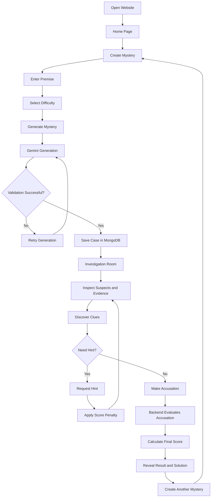

# AI MYSTERY ROOM
## Master Product & Technical Specification

# 1. DOCUMENT PURPOSE

This document serves as the Single Source of Truth (SSOT) for the entire AI Mystery Room project.

It defines the product requirements, user journeys, UI/UX specifications, backend architecture, database models, API contracts, Gemini AI behavior, game logic, scoring system, security requirements, and acceptance criteria.

AI coding tools such as Codex must use this document as the authoritative reference when implementing the application.

## 1.1 Rules for AI Coding Tools

1. Read this entire document before implementing any functionality.
2. Follow the requirements and architecture defined here.
3. Do not invent additional core features without documenting the proposed change.
4. Do not change scoring rules, difficulty configurations, or mystery-generation rules.
5. Do not expose the culprit or solution to the frontend before accusation submission.
6. All business logic, validation, and scoring must be implemented on the backend.
7. Use reusable components and modular services.
8. Implement the application incrementally and verify each phase.
9. Never use fake API responses or nonfunctional buttons as substitutes for required functionality.
10. Update this specification whenever an approved architectural or product decision changes.

---

# A. PROJECT REQUIREMENTS

## A1. Project Overview

### Project Name
**AI Mystery Room**

### Tagline
Investigate. Discover. Connect the Clues. Find the Culprit.

### Description

AI Mystery Room is an AI-powered interactive detective investigation web application where users create and solve unique mysteries generated using Google's Gemini API.

Unlike traditional mystery games with predefined stories and fixed puzzles, this application allows users to enter their own mystery premise and customize its difficulty.

Gemini uses the supplied premise to generate a complete mystery containing:

- A detailed crime or incident story.
- Multiple suspects with individual backgrounds and motives.
- A predetermined culprit.
- A collection of logical clues.
- Fictional WhatsApp conversations.
- CCTV recordings or surveillance evidence.
- Photographic evidence.
- Documents and witness statements.
- Progressive investigation hints.
- A complete hidden solution and explanation.

Players investigate the generated case, examine evidence, discover clues, request hints, connect suspicious events, and ultimately identify the culprit.

The application evaluates the final accusation using predefined scoring rules and reveals the complete solution.

### A2. Problem Statement

Traditional mystery-solving games generally offer predefined scenarios and limited replayability.

Players often experience the same suspects, clues, and solutions, reducing the excitement of repeated investigations.

Additionally, many mystery games provide insufficient interaction with evidence, making investigations feel like simple multiple-choice quizzes.

AI Mystery Room addresses these problems through AI-generated, customizable mysteries.

It provides a dynamic investigation environment where every case can have a different premise, story, set of suspects, evidence, and solution.

The application aims to combine:

- Generative AI.
- Logical reasoning.
- Interactive storytelling.
- Evidence-based investigation.
- Gamification.
- Dynamic content generation.

### A3. Project Objectives

The primary objectives are:

1. Allow users to create custom mystery scenarios.
2. Generate unique mysteries using Gemini.
3. Generate logically consistent suspects and clues.
4. Provide realistic, interactive digital evidence.
5. Allow users to discover clues progressively.
6. Provide hints without directly revealing the solution.
7. Evaluate the final accusation.
8. Calculate scores based on difficulty and investigation performance.
9. Reveal a complete explanation after case completion.
10. Support repeated mystery generation and replayability.

### A4. Target Users

| User Group | Description |
|---|---|
| Casual Gamers | People interested in interactive mystery games |
| Puzzle Enthusiasts | Users who enjoy logical reasoning and problem-solving |
| Detective Game Fans | Players interested in criminal investigations |
| Storytelling Enthusiasts | Users who enjoy AI-generated narratives |
| Students | Users interested in analytical thinking and deduction |

### A5. Expected User Experience

The application should provide an immersive detective experience.

The player should feel like an investigator examining a real case rather than someone interacting with a basic chatbot.

The experience must include:

- A cinematic dark-themed interface.
- An engaging mystery creation process.
- Clear suspect profiles.
- Interactive evidence viewers.
- A structured investigation workspace.
- Progressive hints.
- A meaningful final accusation.
- A detailed verdict and scoring breakdown.

**Core UX principle:** Players must solve the mystery using evidence and reasoning. The application must not reveal the culprit before the final accusation.

## A6. Core Features

The following features are mandatory for the MVP.

| ID | Feature | Description | Priority |
|---|---|---|---|
| F01 | Home Page | Introduce the application and allow users to start | P0 |
| F02 | Mystery Creation | Accept a user-defined mystery premise | P0 |
| F03 | Difficulty Selection | Support Easy, Medium, and Hard | P0 |
| F04 | Gemini Integration | Generate structured mysteries | P0 |
| F05 | Suspect Generation | Generate difficulty-based suspects | P0 |
| F06 | Clue Generation | Generate difficulty-based clues | P0 |
| F07 | Evidence Generation | Generate digital and visual evidence | P0 |
| F08 | Investigation Room | Provide an interactive investigation interface | P0 |
| F09 | Clue Discovery | Allow players to discover clues | P0 |
| F10 | Hint System | Provide progressive hints | P0 |
| F11 | Final Accusation | Allow players to select a culprit | P0 |
| F12 | Scoring Engine | Calculate final scores | P0 |
| F13 | Result Page | Reveal verdict and solution | P0 |
| F14 | New Mystery | Allow another mystery to be created | P0 |
| F15 | Investigation Persistence | Preserve case progress | P0 |

## A7. Optional Enhancements

These features are outside the initial MVP and must not delay core implementation.

| Feature | Description | Priority |
|---|---|---|
| User Authentication | Registration and login | P1 |
| User Dashboard | View previous investigations | P1 |
| Investigation History | Resume saved mysteries | P1 |
| AI Detective Assistant | Ask contextual questions about evidence | P1 |
| Leaderboard | Compare player scores | P2 |
| Multiplayer | Multiple players investigate together | P2 |
| Voice Investigation | Interact with the detective assistant using voice | P2 |
| Custom Media Generation | Generate advanced cinematic CCTV videos | P2 |
| Achievements | Reward investigation milestones | P2 |

## A8. Technology Stack

The project must use the following technologies.

| Layer | Technology | Purpose |
|---|---|---|
| Frontend | React.js | Component-based UI |
| Build Tool | Vite | Frontend development and bundling |
| Styling | Tailwind CSS | Responsive design |
| Routing | React Router | Client-side navigation |
| State Management | Zustand | Application and investigation state |
| Backend Runtime | Node.js | Server execution |
| Backend Framework | Express.js | REST API implementation |
| Database | MongoDB | Persistent data storage |
| ODM | Mongoose | MongoDB schema management |
| AI Provider | Google Gemini API | Mystery and evidence generation |
| Validation | Zod | Request and AI output validation |
| HTTP Client | Axios | Frontend API communication |
| Testing | Vitest | Frontend and unit testing |
| API Testing | Supertest | Backend endpoint testing |
| Deployment | Vercel/Netlify + Render/Railway or equivalent | Hosting |

### A8.1 Architecture

The application must follow a client-server architecture.

```text
                    PLAYER
                      |
                      v
               REACT APPLICATION
                      |
                      v
                 VITE CLIENT
                      |
                 AXIOS REQUEST
                      |
                      v
              NODE.JS + EXPRESS
                      |
          +-----------+-----------+
          |           |           |
          v           v           v
      CASE SERVICE  GAME SERVICE  AI SERVICE
          |           |           |
          |           |           v
          |           |       GEMINI API
          |           |           |
          |           |           v
          |           |     STRUCTURED OUTPUT
          |           |
          +-----------+-----------+
                      |
                      v
                  MONGODB
                      |
                      v
              VALIDATED CASE DATA
                      |
                      v
               REACT APPLICATION
```

### A8.2 Architectural Rules

- React must not communicate directly with Gemini.
- All Gemini API requests must originate from the backend.
- MongoDB must store generated cases and player progress.
- Express must expose REST APIs under `/api`.
- Mongoose must manage database schemas.
- Zod must validate incoming requests and Gemini responses.
- The backend must control the game lifecycle and scoring.
- The solution must remain server-side until the accusation is submitted.

## A9. Project Limitations and Scope

The initial version has the following limitations:

1. The application focuses on single-player investigations.
2. Users can investigate one mystery at a time within a particular investigation session.
3. Each case has one predetermined culprit.
4. Mystery generation depends on Gemini API availability and quotas.
5. AI-generated content may require validation and regeneration.
6. Actual video generation is not guaranteed by the Gemini text-generation API.
7. CCTV evidence can initially use generated surveillance frames, timestamps, event logs, and descriptions.
8. WhatsApp-style evidence will be rendered through a fictional chat interface using generated messages.
9. All generated cases are fictional.
10. Advanced multiplayer, voice features, and leaderboards are excluded from the MVP.

### A9.1 Media Generation Strategy

Gemini will generate structured evidence content and media-generation descriptions.

The frontend will render:

- WhatsApp-style conversations from structured messages.
- CCTV footage using available generated video files or a simulated surveillance player with generated frames and event logs.
- Photographic evidence using generated images or an approved image-generation provider.
- Documents using structured generated content and frontend templates.

Media generation must be implemented through a separate service interface so additional providers can be integrated later.

The application must not claim that a video or image has been generated when only a textual description exists.

## A10. Final Deliverables

The completed project must include:

1. A functional React frontend.
2. A Node.js and Express backend.
3. MongoDB database integration.
4. Gemini API integration.
5. Mystery generation functionality.
6. Interactive investigation interface.
7. Suspect and clue management.
8. Hint system.
9. Accusation functionality.
10. Backend scoring engine.
11. Result and solution reveal page.
12. Responsive design.
13. Environment configuration.
14. API documentation.
15. README with setup and deployment instructions.
16. Automated tests for critical business logic.

---

# B. USER FLOW

## B1. Complete User Journey

The following sequence defines the mandatory user journey.

### Step 1: User Opens the Website

The user visits the AI Mystery Room homepage.

The homepage introduces the application and displays a prominent button:

**Start Investigation**

The user can start creating a mystery without mandatory registration in the MVP.

### Step 2: User Creates a Mystery

The user navigates to the Create Mystery page.

The page contains:

- Mystery premise input.
- Difficulty selector.
- Generate Mystery button.

The premise is a natural-language description of the mystery the user wants to investigate.

Example premise:

"A wealthy businessman is found dead in his mansion during a private party. Four people were present that night, each having a different motive. One of them committed the crime, but everyone is hiding something."

The user selects a difficulty:

- Easy
- Medium
- Hard

The user clicks Generate Mystery.

### Step 3: Gemini Generates the Mystery

The backend receives the premise and difficulty.

The backend sends a structured generation request to Gemini.

Gemini generates:

1. Mystery title.
2. Incident description.
3. Victim details.
4. Suspect profiles.
5. Hidden culprit.
6. Incident timeline.
7. Clues.
8. Digital evidence.
9. Progressive hints.
10. Final solution and explanation.

The backend validates the complete response.

If validation succeeds, the mystery is saved in MongoDB.

If validation fails, the backend retries generation within a predefined retry limit.

The user sees a loading screen while the case is generated.

### Step 4: User Enters the Investigation Room

The user is redirected to the Investigation Room.

The page displays:

- Mystery title.
- Incident story.
- Victim details.
- Suspect cards.
- Available evidence.
- Investigation progress.
- Hint button.
- Final accusation action.

The player can inspect suspects and evidence.

### Step 5: User Investigates and Discovers Clues

The user opens evidence items.

Examples:

- WhatsApp conversations.
- CCTV footage or event logs.
- Crime scene photographs.
- Emails.
- Documents.
- Witness statements.

The player identifies useful information and clicks Discover Clue where applicable.

The discovered clue is saved to the investigation record.

Each newly discovered clue awards 5 points.

Repeated discovery of the same clue must not award additional points.

### Step 6: User Requests Hints

If the player cannot solve the mystery, they can request a hint.

Hints are progressive.

Each hint costs 10 points.

The maximum number of hints depends on the selected difficulty:

- Easy: 2 hints.
- Medium: 3 hints.
- Hard: 3 hints.

The player must see a confirmation before a hint is consumed.

### Step 7: User Accuses a Suspect

The user clicks Make Final Accusation.

The application displays all suspects as selectable options.

The player selects one suspect and optionally provides reasoning.

After confirmation, the frontend submits the suspect ID to the backend.

The backend evaluates the accusation against the hidden culprit.

### Step 8: Application Reveals the Verdict

The backend calculates the score.

The result page displays:

- Correct or incorrect verdict.
- Actual culprit.
- Complete explanation.
- Motive.
- Method.
- Important clues.
- Timeline reconstruction.
- Scoring breakdown.

The hidden solution is revealed only after this stage.

### Step 9: User Starts Another Mystery

The result page contains:

**Create Another Mystery**

Clicking this button navigates to the Create Mystery page and allows the user to start a new investigation.

## B2. User Flow Diagram



## B3. Investigation State Lifecycle

Every case must follow this lifecycle:

```text
GENERATING
    |
    v
ACTIVE
    |
    v
ACCUSATION_SUBMITTED
    |
    v
COMPLETED
```

Additional state:

- FAILED: Mystery generation failed after allowed retries.
- ABANDONED: Player explicitly leaves or abandons an active case, if abandonment support is implemented.

Rules:

- Only ACTIVE cases can accept discoveries and hints.
- Only ACTIVE cases can accept an accusation.
- ACCUSATION_SUBMITTED must transition to COMPLETED atomically.
- COMPLETED cases are read-only.
- A completed case cannot receive another accusation.

---

# C. UI AND PAGE SPECIFICATIONS

## C1. Overall Design Direction

The application must have a cinematic detective-investigation aesthetic.

### Design Philosophy

The interface should resemble a professional detective workspace.

Use:

- Dark charcoal backgrounds.
- Deep navy panels.
- Muted red accent colors.
- Warm white typography.
- Subtle borders.
- Cinematic photographs.
- Evidence cards.
- Clean information hierarchy.
- Smooth, restrained animations.

Avoid excessive animations, clutter, and distracting visual effects.

### Design Tokens

| Token | Value |
|---|---|
| Background | `#0B0D12` |
| Surface | `#151922` |
| Secondary Surface | `#1D2330` |
| Primary Accent | `#B91C1C` |
| Primary Text | `#F5F5F5` |
| Secondary Text | `#9CA3AF` |
| Success | `#16A34A` |
| Warning | `#D97706` |
| Border | `#2B3240` |

## C2. Home Page

**Route:** `/`

### Purpose

Introduce AI Mystery Room and encourage users to create their first mystery.

### Required Elements

1. Application logo and navigation.
2. Hero heading.
3. Short product description.
4. Background detective-themed artwork.
5. Start Investigation button.
6. How It Works section.
7. Features section.
8. Footer.

### Primary CTA

**Create Your Mystery**

Action: Navigate to `/create`.

### Secondary CTA

**How It Works**

Action: Scroll to the explanation section.

### Expected Layout

- Cinematic hero section.
- Main title: "Every Mystery Has a Secret."
- Supporting text explaining the AI-powered investigation experience.
- Prominent call-to-action.
- Feature cards for AI-generated mysteries, digital evidence, and detective challenges.

## C3. Create Mystery Page

**Route:** `/create`

### Purpose

Allow users to provide a mystery premise and select difficulty.

### Required Elements

1. Page heading.
2. Mystery premise textarea.
3. Difficulty selector.
4. Difficulty descriptions.
5. Generate Mystery button.
6. Input validation messages.

### Mystery Premise Input

Label: "Describe Your Mystery"

Placeholder:

"Describe a crime, suspicious incident, disappearance, theft, or mysterious event you want to investigate..."

Rules:

- Required field.
- Minimum 20 characters.
- Maximum 2000 characters.
- Must contain meaningful text after trimming.
- HTML and script injection must be prevented.

### Difficulty Selector

Three selectable cards.

**Easy**

- 3 suspects.
- 5 clues.
- 2 hints.
- Suitable for beginners.

**Medium**

- 4 suspects.
- 7 clues.
- 3 hints.
- Moderate investigation complexity.

**Hard**

- 5 suspects.
- 9 clues.
- 3 hints.
- Complex evidence and misleading information.

### Generate Button

Text: "Generate Mystery"

On click:

1. Validate inputs.
2. Disable repeated submission.
3. Send the request to the backend.
4. Display the generation loading state.
5. Navigate to the investigation page after successful generation.

## C4. Mystery Generation Loading State

**Purpose:** Communicate that the AI is constructing a complete investigation.

Display:

- Animated detective loading illustration.
- "Building Your Mystery..."
- Progress messages.

Suggested messages:

1. "Analyzing your mystery premise..."
2. "Creating suspects and their motives..."
3. "Constructing the incident timeline..."
4. "Generating evidence and clues..."
5. "Validating the mystery..."
6. "Preparing your investigation room..."

The frontend must not pretend that these messages represent exact AI processing stages unless the backend provides corresponding status updates.

If generation fails, show:

"Unable to generate your mystery. Please try again."

Provide a Retry button.

## C5. Investigation Room

**Route:** `/investigation/:id`

### Purpose

Provide the primary detective investigation experience.

This is the most important screen in the application.

### Main Layout

Use a three-section desktop layout.

**Left Sidebar — Case Information**

- Case title.
- Incident summary.
- Suspect list.
- Evidence categories.
- Investigation progress.

**Center Panel — Evidence Viewer**

- Selected evidence.
- Story and incident details.
- Chat viewer.
- CCTV viewer.
- Image viewer.
- Document viewer.
- Clue discovery action.

**Right Sidebar — Investigation Tools**

- Hints.
- Discovered clue count.
- Score.
- Progress indicator.
- Make Final Accusation button.

### Investigation Header

Display:

- Case title.
- Difficulty.
- Case status.
- Current score.

### Suspect Cards

Each card must contain:

- Suspect name.
- Profile image or avatar.
- Occupation.
- Relationship to victim.
- Publicly available background.
- View Details action.

The interface must not expose the culprit or a definitive guilt indicator.

### Evidence Cards

Each evidence card must contain:

- Evidence title.
- Evidence category.
- Short description.
- Timestamp, where applicable.
- Reviewed/discovered status.
- Open Evidence action.

### Supported Evidence Types

**1. CHAT**

Render fictional messaging conversations.

Required fields:

- Sender.
- Recipient or group.
- Message text.
- Timestamp.
- Message sequence.
- Optional deleted-message marker.

The chat must be displayed as a realistic conversation interface.

**2. CCTV**

Display:

- Camera name.
- Location.
- Recording timestamp.
- Video or generated surveillance frames.
- Event description.
- Relevant timestamps.

If actual video generation is unavailable, provide a clearly represented CCTV simulation using generated frames and event logs.

**3. IMAGE**

Display:

- Generated photograph.
- Caption.
- Location.
- Timestamp.
- Related evidence details.

**4. DOCUMENT**

Display:

- Document title.
- Document type.
- Generated text.
- Author or source.
- Timestamp.

### Clue Discovery

Each clue must have a dedicated Discover button.

When clicked:

1. Send the discovery request to the backend.
2. Verify the clue belongs to the case.
3. Check that it has not already been discovered.
4. Update investigation progress.
5. Award 5 points if it is newly discovered.
6. Return the updated score and clue status.

Display a success notification:

"Clue discovered! +5 points."

Repeated discovery must not award additional points.

### Progress Display

Display:

- Total clues.
- Discovered clues.
- Hints used.
- Current score.
- Investigation completion percentage.

Completion percentage must be calculated from discovered clues divided by total clues.

### Final Accusation Button

Display a prominent button:

"Make Final Accusation"

This navigates to `/investigation/:id/accuse`.

## C6. Accusation Page

**Route:** `/investigation/:id/accuse`

### Purpose

Allow the player to select the person they believe committed the crime.

### Required Elements

- Case title.
- Accusation instructions.
- Suspect selection cards.
- Optional reasoning textarea.
- Selected suspect confirmation.
- Submit Accusation button.

### Selection Rules

- Exactly one suspect must be selected.
- Selected suspect must belong to the current case.
- Reasoning is optional.
- Reasoning maximum length: 1000 characters.
- Submission requires explicit confirmation.

### Confirmation Modal

Before submission:

"Are you sure you want to submit your final accusation? You cannot change your decision after submission."

Buttons:

- Go Back.
- Submit Final Accusation.

After submission, the investigation becomes completed.

## C7. Results Page

**Route:** `/investigation/:id/results`

### Purpose

Reveal the verdict and explain the mystery.

### Required Elements

1. Verdict banner.
2. Correct or incorrect status.
3. Actual culprit.
4. Culprit profile.
5. Crime motive.
6. Method of committing the crime.
7. Complete mystery explanation.
8. Critical clue analysis.
9. Timeline reconstruction.
10. Scoring breakdown.
11. Final score.
12. Create Another Mystery button.

### Verdict States

Correct accusation:

"Case Solved! You identified the culprit."

Incorrect accusation:

"Case Not Solved. The evidence reveals a different culprit."

The actual culprit must be revealed in both completed-result states.

### Scoring Breakdown

Display:

- Base accusation points.
- Points earned from discovered clues.
- Hint penalties.
- Final score.

### New Mystery Action

Clicking Create Another Mystery navigates to `/create`.

## C8. Navigation

The application must provide consistent navigation.

| Page | Navigation |
|---|---|
| Home | Create Mystery |
| Create Mystery | Back to Home |
| Investigation | Case Overview, Suspects, Evidence, Hints, Accusation |
| Accusation | Back to Investigation |
| Results | Create Another Mystery |

Prevent accidental loss of active investigation progress.

## C9. Responsive Behavior

### Desktop

- Three-column investigation layout.
- Full evidence viewer.
- Persistent sidebars.

### Tablet

- Two-column layout where appropriate.
- Collapsible investigation tools.
- Responsive evidence cards.

### Mobile

- Single-column layout.
- Sidebars converted to drawers or tabs.
- Full-width evidence cards.
- Touch-friendly controls.
- Readable chat and document viewers.
- Sticky investigation action where appropriate.

Minimum supported viewport width: 320px.

## C10. Global Loading and Error States

Every API-dependent page must include:

- Initial loading state.
- Empty state.
- Success state.
- Error state.
- Retry action where appropriate.

Expected errors:

| Scenario | Message |
|---|---|
| Empty premise | Please enter a mystery premise. |
| Invalid difficulty | Please select a valid difficulty. |
| Gemini unavailable | AI service is temporarily unavailable. |
| Generation failed | Unable to generate your mystery. Try again. |
| Case not found | This mystery could not be found. |
| Invalid clue | The requested clue does not exist. |
| Already discovered | You have already discovered this clue. |
| Hint limit reached | You have used all available hints. |
| Invalid suspect | Please select a valid suspect. |
| Case completed | This investigation has already been completed. |
| Network failure | Connection failed. Please try again. |

## C11. Stitch AI Design Mapping

Stitch AI may be used to generate initial visual designs.

The resulting designs must map to the following application components:

| Stitch Screen | Application Page |
|---|---|
| Landing Screen | Home |
| Mystery Setup | Create Mystery |
| Detective Workspace | Investigation Room |
| Suspect Selection | Accusation |
| Case Resolution | Results |

Generated designs are references for implementation, not replacements for this specification.

Codex must implement actual functionality within the designed interfaces.

---

# D. BACKEND AND DATABASE DESIGN

## D1. Backend Architecture

Use a modular Express.js architecture.

```text
server/
├── src/
│   ├── config/
│   │   ├── database.js
│   │   └── gemini.js
│   │
│   ├── models/
│   │   ├── Case.js
│   │   └── Investigation.js
│   │
│   ├── routes/
│   │   └── case.routes.js
│   │
│   ├── controllers/
│   │   └── case.controller.js
│   │
│   ├── services/
│   │   ├── case.service.js
│   │   ├── mystery.service.js
│   │   ├── evidence.service.js
│   │   ├── hint.service.js
│   │   ├── scoring.service.js
│   │   └── gemini.service.js
│   │
│   ├── validators/
│   │   ├── case.validator.js
│   │   └── accusation.validator.js
│   │
│   ├── middleware/
│   │   ├── error.middleware.js
│   │   └── rateLimit.middleware.js
│   │
│   ├── prompts/
│   │   └── mystery.prompt.js
│   │
│   ├── utils/
│   │   └── apiResponse.js
│   │
│   ├── app.js
│   └── server.js
│
└── tests/
```

## D2. API Conventions

Base URL:

`/api`

All API requests and responses must use JSON except where media uploads are explicitly introduced.

All API endpoints must return a consistent response format.

### Success Response

```json
{
  "success": true,
  "message": "Request completed successfully",
  "data": {}
}
```

### Error Response

```json
{
  "success": false,
  "message": "Request failed",
  "error": {
    "code": "VALIDATION_ERROR",
    "details": []
  }
}
```

## D3. API Endpoints

### Endpoint 1: Generate Mystery

**POST `/api/cases`**

Purpose: Generate a mystery from the user's premise and selected difficulty.

Request:

```json
{
  "premise": "A businessman is found dead in his mansion during a private party. Four people were present, and one of them is responsible.",
  "difficulty": "medium"
}
```

Validation:

- Premise required.
- Premise minimum 20 characters.
- Premise maximum 2000 characters.
- Difficulty must be `easy`, `medium`, or `hard`.

Successful response:

```json
{
  "success": true,
  "message": "Mystery generated successfully",
  "data": {
    "caseId": "CASE_ID",
    "title": "The Midnight Mystery",
    "difficulty": "medium",
    "story": "The incident description...",
    "suspects": [],
    "clues": [],
    "hintsAvailable": 3,
    "status": "active"
  }
}
```

Security: This endpoint must never return the culprit or hidden solution.

### Endpoint 2: Retrieve Mystery

**GET `/api/cases/:id`**

Purpose: Retrieve the public information of an active mystery.

Response:

```json
{
  "success": true,
  "message": "Case retrieved successfully",
  "data": {
    "caseId": "CASE_ID",
    "title": "The Midnight Mystery",
    "story": "Mystery story...",
    "difficulty": "medium",
    "victim": {},
    "suspects": [],
    "clues": [],
    "evidence": [],
    "investigation": {
      "discoveredClues": [],
      "hintsUsed": [],
      "score": 0
    },
    "status": "active"
  }
}
```

The response must omit:

- Culprit ID.
- Hidden motive.
- Complete solution.
- Private clue explanations that reveal the answer.
- Internal AI validation data.

### Endpoint 3: Discover a Clue

**POST `/api/cases/:id/clues/:clueId/discover`**

Purpose: Mark a clue as discovered.

Request:

```json
{}
```

Response:

```json
{
  "success": true,
  "message": "Clue discovered successfully",
  "data": {
    "clueId": "CLUE_ID",
    "discovered": true,
    "pointsAwarded": 5,
    "score": 5,
    "discoveredClues": 1
  }
}
```

Rules:

- The clue must belong to the case.
- The case must be active.
- Repeated discovery must not award points.
- Backend must update progress atomically.

### Endpoint 4: Request Hint

**POST `/api/cases/:id/hints`**

Purpose: Reveal the next available hint.

Request:

```json
{}
```

Response:

```json
{
  "success": true,
  "message": "Hint revealed successfully",
  "data": {
    "hintLevel": 1,
    "hint": "Pay attention to the timing of the messages.",
    "pointsDeducted": 10,
    "score": 0,
    "hintsRemaining": 2
  }
}
```

Rules:

- Hints must be served sequentially.
- The next unused hint must be returned.
- Repeated requests must not reveal the same hint with another penalty.
- A hint cannot be requested after the limit is reached.
- Hint use and score deduction must happen atomically.

### Endpoint 5: Submit Accusation

**POST `/api/cases/:id/accuse`**

Purpose: Submit the player's final suspect selection.

Request:

```json
{
  "suspectId": "SUSPECT_02",
  "reasoning": "The CCTV timeline contradicts this suspect's statement."
}
```

Validation:

- Suspect ID is required.
- Suspect must belong to the case.
- Case must be active.
- Reasoning is optional.
- Reasoning maximum length is 1000 characters.
- Only one accusation is permitted per case.

Response:

```json
{
  "success": true,
  "message": "Accusation submitted successfully",
  "data": {
    "caseId": "CASE_ID",
    "investigationStatus": "completed",
    "isCorrect": true,
    "score": 155,
    "resultUrl": "/investigation/CASE_ID/results"
  }
}
```

The accusation response may return the verdict and final score, but the complete solution should be obtained through the results endpoint.

### Endpoint 6: Retrieve Result

**GET `/api/cases/:id/result`**

Purpose: Retrieve the completed investigation result.

Response:

```json
{
  "success": true,
  "message": "Investigation result retrieved successfully",
  "data": {
    "caseId": "CASE_ID",
    "verdict": "correct",
    "selectedSuspectId": "SUSPECT_02",
    "culprit": {
      "id": "SUSPECT_02",
      "name": "John Anderson"
    },
    "explanation": "Complete solution...",
    "motive": "Financial dispute...",
    "method": "Detailed explanation...",
    "criticalClues": [],
    "timeline": [],
    "scoreBreakdown": {
      "basePoints": 150,
      "cluePoints": 35,
      "hintPenalty": 30,
      "finalScore": 155
    },
    "finalScore": 155
  }
}
```

Rules:

- Only completed cases can return the solution.
- An active case must not expose its solution.
- Result data must come from the stored case, not newly generated AI output.
- Score must come from the stored backend calculation.

### Endpoint 7: Health Check

**GET `/api/health`**

Response:

```json
{
  "success": true,
  "message": "AI Mystery Room API is running"
}
```

## D4. Error Handling

The backend must use centralized error middleware.

Required HTTP status codes:

| Status | Meaning |
|---|---|
| 200 | Successful retrieval or operation |
| 201 | Mystery created |
| 400 | Invalid request |
| 404 | Case or clue not found |
| 409 | Invalid case state or duplicate action |
| 422 | AI output validation failure |
| 429 | Rate limit exceeded |
| 500 | Internal server error |
| 502 | Gemini provider error |
| 503 | AI service unavailable |

Never return API keys, database credentials, stack traces, or private solution data in error responses.

## D5. Database Design

MongoDB is the primary persistent database.

The MVP requires two main collections:

1. Cases
2. Investigations

### Collection 1: Cases

Model: `Case`

Suggested schema:

```javascript
{
  _id: ObjectId,

  title: String,
  premise: String,
  story: String,
  category: String,

  difficulty: {
    type: String,
    enum: ["easy", "medium", "hard"]
  },

  status: {
    type: String,
    enum: ["generating", "active", "failed"]
  },

  victim: {
    name: String,
    age: Number,
    occupation: String,
    description: String
  },

  suspects: [
    {
      suspectId: String,
      name: String,
      age: Number,
      occupation: String,
      relationship: String,
      motive: String,
      alibi: String,
      statement: String,
      publicDescription: String
    }
  ],

  clues: [
    {
      clueId: String,
      title: String,
      description: String,
      type: String,
      evidenceId: String,
      importance: String,
      relatedSuspects: [String],
      discoveryText: String,
      solutionExplanation: String
    }
  ],

  evidence: [
    {
      evidenceId: String,
      type: String,
      title: String,
      description: String,
      content: Object,
      mediaUrl: String,
      timestamp: String,
      relatedSuspects: [String]
    }
  ],

  timeline: [
    {
      time: String,
      event: String,
      relatedSuspects: [String]
    }
  ],

  hints: [
    {
      level: Number,
      content: String
    }
  ],

  solution: {
    culpritId: String,
    motive: String,
    method: String,
    explanation: String,
    criticalClueIds: [String],
    redHerringExplanations: [String]
  },

  generationMetadata: {
    model: String,
    promptVersion: String,
    generatedAt: Date,
    validationStatus: String
  },

  createdAt: Date,
  updatedAt: Date
}
```

The `solution` field is private.

It must never be included in normal case retrieval responses.

### Collection 2: Investigations

Model: `Investigation`

Suggested schema:

```javascript
{
  _id: ObjectId,

  caseId: ObjectId,

  status: {
    type: String,
    enum: [
      "active",
      "completed",
      "abandoned"
    ]
  },

  discoveredClues: [String],

  hintsUsed: [Number],

  score: Number,

  accusation: {
    suspectId: String,
    reasoning: String,
    submittedAt: Date,
    isCorrect: Boolean
  },

  scoreBreakdown: {
    basePoints: Number,
    cluePoints: Number,
    hintPenalty: Number,
    finalScore: Number
  },

  startedAt: Date,
  completedAt: Date,

  createdAt: Date,
  updatedAt: Date
}
```

### D6. Database Relationships

```text
CASE
 |
 +-- Victim
 |
 +-- Suspects
 |
 +-- Clues
 |
 +-- Evidence
 |
 +-- Timeline
 |
 +-- Hints
 |
 +-- Hidden Solution
 |
 +-- INVESTIGATION
        |
        +-- Discovered Clues
        |
        +-- Hints Used
        |
        +-- Accusation
        |
        +-- Score
        |
        +-- Result
```

### D7. Data Integrity Rules

1. Every case must have a unique ID.
2. Every suspect must have a unique suspect ID within the case.
3. Every clue must have a unique clue ID within the case.
4. Every evidence item must have a unique evidence ID within the case.
5. Every clue must reference valid evidence where applicable.
6. Every solution culprit ID must reference an existing suspect.
7. Every hint must have a valid difficulty-specific level.
8. Every investigation must reference a valid case.
9. Discovery records must not contain duplicate clue IDs.
10. Hint records must not contain duplicate levels.
11. Completed investigations must be immutable.
12. The solution must remain private until completion.

### D8. Security Requirement

The culprit and solution must remain on the backend until the player submits an accusation.

This is a mandatory architectural requirement.

Implement separate data serializers:

- `toPublicCase()`: Returns safe case data.
- `toResultCase()`: Returns complete solution data only after completion.

Never send the complete Mongoose document directly to the frontend.

Do not rely on frontend state, hidden HTML, disabled buttons, or CSS to protect the culprit.

If multiple users or guest sessions are supported, use a secure session ownership mechanism and enforce access control on every investigation endpoint.

---

# E. AI BEHAVIOR AND SCORING RULES

## E1. Gemini Integration

Google Gemini is the primary AI engine.

Gemini must generate all mystery content in a structured format.

The backend must integrate Gemini through a dedicated service.

Example service responsibilities:

- Initialize Gemini client.
- Send generation prompts.
- Request structured JSON output.
- Parse model responses.
- Validate output.
- Handle errors and retries.
- Return validated mystery data.

The model name must be configurable through environment variables.

The Gemini API key must never be exposed to the client.

## E2. Difficulty Configuration

The following configuration is mandatory and must not be changed without approval.

| Difficulty | Suspects | Clues | Hints |
|---|---:|---:|---:|
| Easy | 3 | 5 | 2 |
| Medium | 4 | 7 | 3 |
| Hard | 5 | 9 | 3 |

The backend must determine the required counts using the selected difficulty.

Gemini must not decide these counts independently.

## E3. Mystery Generation Requirements

Every generated mystery must contain:

1. A unique case title.
2. A complete incident story.
3. A defined victim or affected party.
4. The exact number of suspects required by difficulty.
5. The exact number of clues required by difficulty.
6. The exact number of hints required by difficulty.
7. One predetermined culprit.
8. A logical motive.
9. An explanation of the method.
10. A coherent incident timeline.
11. Evidence supporting important clues.
12. A complete final explanation.

Every suspect must have:

- Unique ID.
- Name.
- Age where appropriate.
- Occupation.
- Relationship to the victim.
- Background.
- Motive or plausible reason for suspicion.
- Alibi.
- Initial statement.

Every clue must have:

- Unique ID.
- Title.
- Description.
- Evidence reference.
- Related suspect IDs.
- Discovery text.
- Explanation of its importance.

At least three clues must be meaningfully relevant to solving the case.

Red herrings may be included, but their purpose must be explainable in the final solution.

## E4. Evidence Generation

Evidence must support the mystery and provide information the player can investigate.

Supported evidence types:

| Type | Required Content |
|---|---|
| CHAT | Participants, messages, timestamps |
| CCTV | Camera location, timestamps, event observations, media references |
| IMAGE | Image description, location, timestamp, media reference |
| DOCUMENT | Title, source, content |
| WITNESS | Witness identity, statement, timestamp |

The AI-generated evidence must agree with:

- Suspect profiles.
- Incident timeline.
- Clue relationships.
- Culprit identity.
- Final solution.

### WhatsApp-Style Conversations

Gemini should return structured messages.

Example:

```json
{
  "evidenceId": "EVIDENCE_01",
  "type": "CHAT",
  "title": "Private Conversation",
  "participants": [
    "John",
    "Sarah"
  ],
  "messages": [
    {
      "sender": "John",
      "text": "Did you take the documents?",
      "timestamp": "22:15"
    },
    {
      "sender": "Sarah",
      "text": "Everything is handled.",
      "timestamp": "22:17"
    }
  ]
}
```

The frontend must render these messages using a fictional messaging interface.

### CCTV Evidence

CCTV evidence must contain:

- Camera ID.
- Location.
- Recording date.
- Recording time.
- Event observations.
- Related suspect.
- Associated clue.
- Optional media URL.

The frontend should support playable video when a valid video asset exists.

Otherwise, it must display a surveillance-style frame sequence or event timeline, clearly represented as a simulation.

### Image Evidence

Image evidence should contain:

- Image title.
- Description.
- Image-generation prompt or media reference.
- Associated clue.
- Related suspect.
- Timestamp.

### Document Evidence

Document evidence can include:

- Police reports.
- Witness statements.
- Emails.
- Receipts.
- Medical or forensic reports.
- Personal notes.

All such documents must be fictional.

## E5. Gemini Output Format

Gemini must return valid structured JSON.

The backend must validate the response before saving it.

Canonical output structure:

```json
{
  "title": "The Midnight at Ravenwood",
  "category": "murder",
  "story": "A businessman is discovered dead...",
  "victim": {
    "name": "Robert Wilson",
    "age": 54,
    "occupation": "Businessman",
    "description": "A wealthy businessman..."
  },
  "suspects": [
    {
      "suspectId": "SUSPECT_01",
      "name": "John Anderson",
      "age": 35,
      "occupation": "Personal Assistant",
      "relationship": "Employee",
      "background": "Worked for the victim for eight years.",
      "motive": "Financial dispute.",
      "alibi": "Claims to have been in the library.",
      "statement": "I never entered the study."
    }
  ],
  "timeline": [
    {
      "time": "22:00",
      "event": "The victim enters the study.",
      "relatedSuspects": []
    }
  ],
  "clues": [
    {
      "clueId": "CLUE_01",
      "title": "The Missing Key",
      "description": "A key is discovered near the entrance.",
      "evidenceId": "EVIDENCE_01",
      "relatedSuspects": ["SUSPECT_01"],
      "discoveryText": "The key was not where it was expected.",
      "importance": "critical",
      "solutionExplanation": "The key establishes access to the room."
    }
  ],
  "evidence": [
    {
      "evidenceId": "EVIDENCE_01",
      "type": "CHAT",
      "title": "Suspicious Conversation",
      "description": "A private exchange between two suspects.",
      "timestamp": "22:15",
      "relatedSuspects": ["SUSPECT_01"],
      "content": {
        "participants": ["John", "Sarah"],
        "messages": [
          {
            "sender": "John",
            "text": "Meet me near the study.",
            "timestamp": "22:15"
          }
        ]
      }
    }
  ],
  "hints": [
    {
      "level": 1,
      "content": "Pay attention to the incident timeline."
    }
  ],
  "solution": {
    "culpritId": "SUSPECT_01",
    "motive": "Financial dispute.",
    "method": "Complete explanation of the incident.",
    "explanation": "A detailed reconstruction supported by evidence.",
    "criticalClueIds": ["CLUE_01"],
    "redHerringExplanations": []
  }
}
```

This is a structural example. The actual generation prompt must require all fields and the exact number of objects according to difficulty.

The backend must reject incomplete or invalid responses.

## E6. Mystery Generation Prompt Requirements

The backend prompt must include the following instructions.

**System role:**

"You are an expert mystery writer and detective-game designer. Your task is to create logically consistent, solvable detective mysteries."

**Generation instructions:**

1. Use the user's premise as the foundation.
2. Respect the requested difficulty.
3. Generate the exact required number of suspects.
4. Generate the exact required number of clues.
5. Generate the exact required number of hints.
6. Select exactly one culprit before generating evidence.
7. Construct a consistent timeline.
8. Give every suspect a plausible profile and alibi.
9. Make the culprit identifiable through evidence.
10. Ensure critical conclusions have evidence support.
11. Generate believable but fictional digital evidence.
12. Do not include unexplained contradictions.
13. Make misleading clues logically explainable.
14. Ensure that the complete solution explains all critical evidence.
15. Return only valid JSON matching the specified schema.

The prompt must explicitly prohibit changing the culprit after evidence generation.

## E7. AI Output Validation

Before saving a generated mystery, the backend must validate:

### Structural Validation

- Required fields exist.
- Correct data types.
- Exact suspect count.
- Exact clue count.
- Exact hint count.
- Valid evidence types.
- Unique IDs.
- Valid references.
- Valid culprit ID.

### Logical Validation

- Culprit exists in the suspect list.
- Critical clues support the culprit.
- The timeline is chronologically consistent.
- Evidence timestamps agree with the timeline.
- Suspect statements do not create unexplained contradictions.
- Hints do not directly reveal the culprit.
- The final explanation accounts for critical evidence.
- Red herrings have an explanation.

### Validation Failure

If validation fails:

1. Do not save the case as playable.
2. Record the validation error internally.
3. Retry generation with corrective instructions.
4. Use a maximum of three generation attempts.
5. If all attempts fail, return a controlled error.

The maximum generation retry count must be configurable.

The backend must never silently accept an invalid mystery.

## E8. Hint Generation Rules

Hints must be generated together with the mystery.

The hint system must be progressive.

**First hint:** General investigative direction.

**Second hint:** Points the player toward a relevant clue or evidence category.

**Third hint:** Identifies an important contradiction or connection without directly naming the culprit.

Difficulty determines the number of hints.

The hint content must be validated against the final solution.

Hints must never:

- Directly reveal the culprit.
- Introduce new evidence.
- Contradict existing clues.
- Change the story.
- Change the final solution.

## E9. Scoring Rules

The scoring system must follow these exact rules.

### Base Accusation Points

| Difficulty | Correct Accusation |
|---|---:|
| Easy | 100 |
| Medium | 150 |
| Hard | 200 |

### Additional Points

- Every newly discovered clue: +5 points.
- Every hint used: -10 points.
- Minimum final score: 0.

### Formula

Let:

- B = Base points for a correct accusation.
- C = Number of discovered clues.
- H = Number of hints used.

Then:

\[
\text{Final Score} =
\max(0, B + 5C - 10H)
\]

For an incorrect accusation:

\[
\text{Final Score} =
\max(0, 5C - 10H)
\]

The incorrect accusation receives no base points.

### Examples

**Example 1: Easy Mystery**

- Correct accusation: 100.
- Discovered clues: 5.
- Hints used: 1.

\[
100 + (5 \times 5) - (10 \times 1) = 115
\]

Final score: **115**

**Example 2: Medium Mystery**

- Correct accusation: 150.
- Discovered clues: 6.
- Hints used: 2.

\[
150 + (6 \times 5) - (2 \times 10) = 160
\]

Final score: **160**

**Example 3: Hard Mystery**

- Correct accusation: 200.
- Discovered clues: 9.
- Hints used: 3.

\[
200 + (9 \times 5) - (3 \times 10) = 215
\]

Final score: **215**

**Example 4: Incorrect Accusation**

- Incorrect accusation.
- Discovered clues: 3.
- Hints used: 2.

\[
\max(0, 15 - 20) = 0
\]

Final score: **0**

### Scoring Implementation

Scoring must be implemented in a dedicated backend service.

Example:

```javascript
const BASE_POINTS = {
  easy: 100,
  medium: 150,
  hard: 200
};

function calculateScore({
  difficulty,
  isCorrect,
  discoveredClues,
  hintsUsed
}) {
  const basePoints = isCorrect
    ? BASE_POINTS[difficulty]
    : 0;

  const cluePoints = discoveredClues * 5;
  const hintPenalty = hintsUsed * 10;

  const finalScore = Math.max(
    0,
    basePoints + cluePoints - hintPenalty
  );

  return {
    basePoints,
    cluePoints,
    hintPenalty,
    finalScore
  };
}
```

The frontend must never calculate or determine the authoritative score.

### Scoring Integrity

- Count unique discovered clues only.
- Count unique consumed hints only.
- Apply hint penalties exactly once.
- Apply base points only for a correct accusation.
- Calculate the score on the backend.
- Save the final score in MongoDB.
- Prevent duplicate accusation submissions.
- Completed scores must not be modified through normal gameplay APIs.

## E10. AI Detective Assistant

The AI Detective Assistant is an optional P1 feature.

If implemented, it must:

- Answer questions using public case information and discovered evidence.
- Avoid revealing the culprit.
- Never fabricate clues.
- Never modify the case.
- Avoid exposing private solution fields.
- Use the backend as the only Gemini integration point.

The assistant must receive a filtered context that excludes the hidden solution.

---

# F. ACCEPTANCE CRITERIA

The application is considered complete only when the following criteria have been satisfied.

## F1. Functional Acceptance Criteria

| ID | Requirement | Expected Result |
|---|---|---|
| AC01 | Homepage | User can access the homepage |
| AC02 | Create Mystery | User can enter a custom premise |
| AC03 | Difficulty | User can select Easy, Medium, or Hard |
| AC04 | Gemini Integration | Backend generates a mystery using Gemini |
| AC05 | Easy Generation | Exactly 3 suspects, 5 clues, and 2 hints |
| AC06 | Medium Generation | Exactly 4 suspects, 7 clues, and 3 hints |
| AC07 | Hard Generation | Exactly 5 suspects, 9 clues, and 3 hints |
| AC08 | Culprit | Exactly one predetermined culprit exists |
| AC09 | Evidence | Mystery contains valid associated evidence |
| AC10 | Investigation | Player can inspect suspects and evidence |
| AC11 | Clue Discovery | Player can discover clues |
| AC12 | Duplicate Prevention | Repeated discoveries award no extra points |
| AC13 | Hint System | Player can request difficulty-specific hints |
| AC14 | Hint Penalty | Every consumed hint deducts 10 points |
| AC15 | Accusation | Player can select and submit one suspect |
| AC16 | Correct Accusation | Correct accusation awards difficulty-based base points |
| AC17 | Incorrect Accusation | Incorrect accusation receives no base points |
| AC18 | Score Floor | Final score can never be below zero |
| AC19 | Solution Security | Culprit is not exposed before accusation |
| AC20 | Results | Results reveal the actual culprit and explanation |
| AC21 | Persistence | Case and investigation data persist in MongoDB |
| AC22 | New Mystery | Player can create another mystery |
| AC23 | Error Handling | AI and API failures are handled gracefully |
| AC24 | Responsive Design | Application works on mobile, tablet, and desktop |
| AC25 | Deployment | Application works on its deployed website |

## F2. AI Acceptance Criteria

- Gemini returns structured JSON.
- Generated JSON passes schema validation.
- Generated mystery follows the selected difficulty.
- Exactly one culprit is defined.
- All suspect references are valid.
- All clue references are valid.
- Evidence supports the final solution.
- Hints are progressive.
- Hints do not directly reveal the culprit.
- Invalid generated cases are rejected.
- Generation failures do not create playable incomplete cases.

## F3. Security Acceptance Criteria

- Gemini API key exists only on the backend.
- Hidden solutions are not included in active-case responses.
- Accusations are verified on the backend.
- Scores are calculated on the backend.
- Duplicate discoveries cannot increase scores.
- Duplicate hint requests cannot cause repeated deductions or reveal extra hints.
- Completed cases cannot be modified through normal gameplay endpoints.
- Invalid IDs and unauthorized access are handled safely.

## F4. UI Acceptance Criteria

- All five primary pages are implemented.
- Navigation works correctly.
- Loading states are displayed.
- Error states are displayed.
- Evidence can be opened and viewed.
- Suspects can be examined.
- Clues can be discovered.
- Hints can be requested.
- Accusations can be submitted.
- Results can be viewed.
- The design adapts to mobile and desktop screens.

## F5. Testing Requirements

The project must include automated tests for:

### Mystery Generation

- Valid Easy mystery.
- Valid Medium mystery.
- Valid Hard mystery.
- Invalid Gemini JSON.
- Incorrect suspect count.
- Incorrect clue count.
- Incorrect hint count.
- Invalid culprit reference.
- Inconsistent evidence references.

### Clue Discovery

- Successful discovery.
- Duplicate discovery.
- Invalid clue ID.
- Discovery after case completion.

### Hint System

- First hint request.
- Sequential hint request.
- Maximum hint limit.
- Duplicate hint prevention.
- Correct score deduction.

### Accusation

- Correct suspect.
- Incorrect suspect.
- Invalid suspect.
- Duplicate accusation.
- Accusation after completion.

### Scoring

Test the following exact cases:

| Test | Expected Score |
|---|---:|
| Easy: Correct, 5 clues, 1 hint | 115 |
| Medium: Correct, 6 clues, 2 hints | 160 |
| Hard: Correct, 9 clues, 3 hints | 215 |
| Easy: Incorrect, 3 clues, 2 hints | 0 |
| Hard: Incorrect, 9 clues, 1 hint | 35 |
| Easy: Correct, 0 clues, 2 hints | 80 |

All tests must pass before release.

## F6. Deployment Acceptance Criteria

The final deployed application must:

1. Load successfully through its public URL.
2. Connect to the deployed MongoDB database.
3. Communicate with the Express backend.
4. Generate mysteries through the deployed Gemini integration.
5. Support the complete investigation flow.
6. Preserve case and investigation data.
7. Evaluate accusations correctly.
8. Display final scores and explanations.
9. Protect backend environment variables.
10. Work on common desktop and mobile browsers.

## F7. Definition of Done

The MVP is complete when a new user can:

1. Open AI Mystery Room.
2. Enter a custom mystery premise.
3. Select a difficulty.
4. Generate a mystery using Gemini.
5. Investigate the generated suspects.
6. Examine fictional digital evidence.
7. Discover clues and earn points.
8. Request hints and receive score penalties.
9. Select and accuse a suspect.
10. Receive a backend-calculated verdict and score.
11. View the complete solution and explanation.
12. Start another mystery.

All these operations must work with actual frontend components, backend APIs, MongoDB persistence, and Gemini integration.

---

# 2. DEVELOPMENT AND IMPLEMENTATION GUIDELINES

## 2.1 Recommended Project Structure

```text
ai-mystery-room/
│
├── client/
│   ├── public/
│   └── src/
│       ├── assets/
│       ├── components/
│       │   ├── common/
│       │   ├── mystery/
│       │   ├── suspects/
│       │   ├── evidence/
│       │   ├── investigation/
│       │   └── results/
│       ├── pages/
│       │   ├── Home.jsx
│       │   ├── CreateMystery.jsx
│       │   ├── InvestigationRoom.jsx
│       │   ├── Accusation.jsx
│       │   └── Results.jsx
│       ├── services/
│       ├── store/
│       ├── hooks/
│       ├── layouts/
│       ├── utils/
│       ├── App.jsx
│       └── main.jsx
│
├── server/
│   ├── src/
│   │   ├── config/
│   │   ├── models/
│   │   ├── routes/
│   │   ├── controllers/
│   │   ├── services/
│   │   ├── validators/
│   │   ├── middleware/
│   │   ├── prompts/
│   │   ├── utils/
│   │   ├── app.js
│   │   └── server.js
│   └── tests/
│
├── docs/
│   ├── SPEC.md
│   ├── IMPLEMENTATION_PLAN.md
│   ├── API.md
│   ├── DATABASE.md
│   └── AI_PROMPTS.md
│
├── .env.example
├── .gitignore
├── package.json
└── README.md
```

## 2.2 Environment Variables

The repository must include `.env.example`.

```env
# Backend
PORT=5000
NODE_ENV=development

# MongoDB
MONGODB_URI=

# Gemini
GEMINI_API_KEY=
GEMINI_MODEL=

# Frontend
CLIENT_URL=http://localhost:5173

# Optional media provider
MEDIA_PROVIDER=
MEDIA_API_KEY=
```

Actual secrets must remain in environment variables and must never be committed to the repository.

## 2.3 Development Phases

Codex must implement the application in the following order.

| Phase | Work | Completion Requirement |
|---|---|---|
| Phase 1 | React/Vite and Express setup | Both applications run |
| Phase 2 | MongoDB and Mongoose | Database connection verified |
| Phase 3 | UI pages and navigation | Five primary pages implemented |
| Phase 4 | Gemini mystery generation | Validated cases generated |
| Phase 5 | Investigation room | Suspects and evidence accessible |
| Phase 6 | Clue discovery | Persistent clue tracking |
| Phase 7 | Hint system | Sequential hints and penalties |
| Phase 8 | Accusation and scoring | Backend evaluation works |
| Phase 9 | Results page | Complete solution revealed |
| Phase 10 | Testing and deployment | All acceptance criteria pass |

A phase must not be considered complete until its implementation and tests have been verified.

---

# 3. CODEX EXECUTION INSTRUCTIONS

Codex is responsible for implementing the complete project according to this specification.

Before implementation:

1. Read `docs/SPEC.md`.
2. Understand all A–F requirements.
3. Identify implementation dependencies.
4. Create `docs/IMPLEMENTATION_PLAN.md`.
5. Identify any conflicts or missing technical decisions before coding.

During implementation:

- Follow the defined technology stack.
- Follow the folder structure.
- Use reusable React components.
- Use modular Express services.
- Use Mongoose for database operations.
- Use Gemini through the backend only.
- Use Zod for validation.
- Implement the exact difficulty configurations.
- Implement the exact scoring formula.
- Protect the hidden solution.
- Implement real API integrations.
- Handle loading, empty, success, and error states.
- Write tests for critical functionality.

After every phase:

1. Run the application.
2. Run relevant tests.
3. Verify the functionality.
4. Fix errors before proceeding.
5. Update `IMPLEMENTATION_PLAN.md`.
6. Document any approved changes.

## Initial Codex Task

Start with project initialization.

Implement:

- React with Vite.
- Tailwind CSS.
- React Router.
- Zustand.
- Node.js and Express.
- MongoDB and Mongoose.
- Zod.
- Axios.
- Environment configuration.
- Basic health-check endpoint.
- Initial folder structure.

Do not implement the complete application in one uncontrolled generation.

Complete each phase incrementally and verify its acceptance criteria.

**Final instruction:** Build the actual AI Mystery Room application described in this specification. Do not produce only a static UI prototype or a collection of disconnected demo pages.

---

# 4. SINGLE SOURCE OF TRUTH POLICY

This document is the authoritative specification for AI Mystery Room.

In case of conflicting implementation assumptions, follow this document.

Any proposed change to the following requires an explicit specification update:

- Difficulty configuration.
- Suspect, clue, and hint counts.
- Mystery generation requirements.
- API contracts.
- Database schemas.
- Scoring rules.
- Solution security.
- Core user journey.
- Acceptance criteria.

All developers and AI coding tools must use the latest approved version of `docs/SPEC.md`.

**END OF SPECIFICATION**